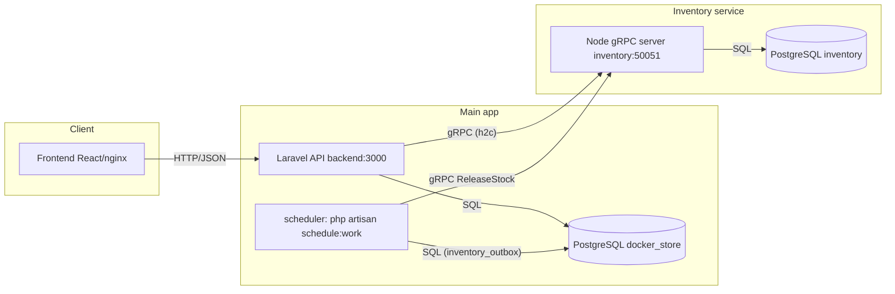
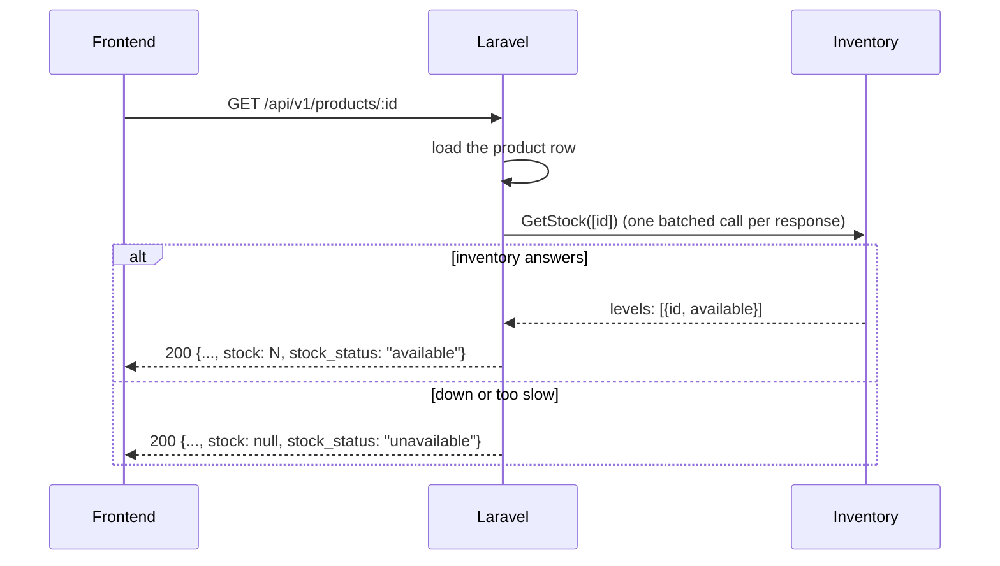

# Inventory over gRPC

Stock management lives in its own service. The main app (Laravel) keeps the
catalog, orders, users and notifications; the **inventory service** (Node.js)
owns quantities and reservations, in its **own database**, and the two talk
over **gRPC** only.

## Architecture



- The contract is `proto/inventory/v1/inventory.proto` — the single source of
  truth. The Node service loads it at runtime (@grpc/proto-loader); the PHP
  message classes in `backend/generated/` are generated from it by protoc.
- The PHP side has no official gRPC extension for this platform, so the client
  (`app/Modules/Inventory/GrpcChannel.php`) speaks the gRPC wire protocol
  directly: HTTP/2 prior knowledge over curl, `application/grpc`
  length-prefixed protobuf frames, `grpc-timeout`, and `grpc-status` /
  `grpc-message` read from the HTTP/2 trailers (or headers, for trailers-only
  errors). Interop was proven both ways against @grpc/grpc-js.
- The main app reaches the inventory only through `InventoryModule`
  (`getStock`, `reserve`, `release`, `adjust`); the architecture test
  (`php artisan test --testsuite=Architecture`) enforces that boundary.

## The contract

```proto
service Inventory {
  rpc GetStock(GetStockRequest) returns (GetStockResponse);         // quantities, batched
  rpc ReserveStock(ReserveStockRequest) returns (ReserveStockResponse); // all-or-nothing
  rpc ReleaseStock(ReleaseStockRequest) returns (ReleaseStockResponse); // idempotent
}
service InventoryAdmin {
  rpc AdjustStock(AdjustStockRequest) returns (AdjustStockResponse); // admin restocking
}
```

Principles:

- **Refusals are data, not errors.** A shortage, an already-released id or a
  below-zero restock comes back as a normal response with a status enum and
  the numbers (`product_id`, `requested`, `available`). gRPC status codes are
  reserved for real failures: `INVALID_ARGUMENT` for bad input, and the
  transport's `UNAVAILABLE` / `DEADLINE_EXCEEDED`.
- **The caller names the reservation.** `reservation_id` is the order's UUID,
  generated before the call: it is the idempotency key and later the handle
  for the release.
- **Deadlines everywhere.** The client sends `grpc-timeout`
  (`INVENTORY_TIMEOUT_MS`, default 2000 ms; connect `INVENTORY_CONNECT_TIMEOUT_MS`,
  500 ms), so no user ever waits on a hung inventory.

## Flows

### Product details (and the product list)



The catalog **never fails because of the inventory**: a page of products makes
exactly one `GetStock` with all its ids, and when that call fails every product
is still returned with `stock: null` and `stock_status: "unavailable"`.

### Create order (reserve → save → compensate)

```mermaid
sequenceDiagram
    participant FE as Frontend
    participant BE as Laravel
    participant INV as Inventory
    participant DB as Main DB

    FE->>BE: POST /api/v1/orders {items}
    BE->>BE: validate, price the lines (404 for unknown products)
    BE->>BE: orderId = new UUID (also the reservation id)
    BE->>INV: ReserveStock(orderId, items)   [ONE call, no DB transaction open]
    alt REFUSED (shortage)
        BE-->>FE: 409 INSUFFICIENT_STOCK {product_id, requested, available}
    else UNAVAILABLE
        BE-->>FE: 503 INVENTORY_UNAVAILABLE (fast: connect timeout)
    else DEADLINE_EXCEEDED
        BE->>DB: outbox += release(orderId)
        BE-->>FE: 504 INVENTORY_TIMEOUT (~2 s)
    else RESERVED
        BE->>DB: one transaction: order + items + history + notification
        alt save fails
            BE->>INV: ReleaseStock(orderId)  (compensation; outbox if it fails too)
            BE-->>FE: 500 INTERNAL_ERROR
        else saved
            BE-->>FE: 201 (order.created published after commit)
        end
    end
```

### Cancel

```mermaid
sequenceDiagram
    participant BE as Laravel
    participant DB as Main DB
    participant INV as Inventory

    BE->>DB: BEGIN; lock order row FOR UPDATE
    BE->>DB: check transition, write status/history/notification
    BE->>DB: INSERT inventory_outbox(reservation_id) ON CONFLICT DO NOTHING
    BE->>DB: COMMIT
    BE->>INV: ReleaseStock(orderId)
    alt delivered
        BE->>DB: DELETE the outbox row
    else failed
        Note over BE,DB: the row stays; the scheduler retries every minute
    end
```

Two admins cancelling at once: the row lock serialises them, the loser sees
`cancelled` and gets `409 INVALID_STATUS_TRANSITION`; only the winner wrote the
outbox row, and releasing is idempotent anyway — stock comes back exactly once.

## Why it can never oversell, leak or double-release

- **Race on the last unit**: the inventory decrements with
  `UPDATE stock SET available = available - q WHERE product_id = $1 AND available >= q`
  inside one transaction. The row lock serialises concurrent reserves; the
  condition re-checks the latest value; the `CHECK (available >= 0)` constraint
  is the last line of defence. Multi-item reserves update rows in sorted
  product_id order, so opposite-order orders can't deadlock.
- **All-or-nothing**: the first shortage rolls the whole reservation back and
  is reported; stock taken for earlier lines in the same request comes back.
- **Idempotency**: the reservation row is keyed by the caller's UUID.
  Replaying a reserve that already succeeded returns `RESERVED` without taking
  stock again; releasing twice returns `ALREADY_RELEASED` and changes nothing.
- **Tombstones**: releasing an id that was never reserved records a
  `released` row (`NOT_FOUND` is returned). If the app timed out and gave up
  while the reserve was still in flight, the reserve that lands later runs
  into that tombstone and is answered `ALREADY_RELEASED` — it can never take
  stock for an order that doesn't exist.
- **The outbox**: every release that must happen but couldn't be delivered (a
  cancel with the inventory down, a compensation after a failed save, a
  timed-out reserve) is recorded in `inventory_outbox` — for a cancel, inside
  the same transaction as the status change, while the row is locked.
  `php artisan inventory:flush-outbox` (scheduled every minute) retries until
  the release lands; a release that already happened answers
  `ALREADY_RELEASED` and the row is dropped. This is **eventual consistency**:
  the moment something fails, stock may be reserved a little longer than
  necessary, but it always comes back, exactly once.

## Running the proofs (demo)

Everything lives in `docs/proofs/`; plain Node, no dependencies, each prints a
clear PASS/FAIL table.

1. **Race on the last unit** — 20 customers, one unit, four API instances:

       # four dev servers (in Docker, point all bases at http://localhost:3000)
       php artisan serve --port=3001 & ... & php artisan serve --port=3004
       set ADMIN_EMAIL / ADMIN_PASSWORD, then:
       node docs/proofs/race-last-unit.js

   Expected: exactly `1 × 201`, `19 × 409 INSUFFICIENT_STOCK`, final stock 0.

2. **Inventory stopped**:

       node docs/proofs/inventory-down.js baseline     # note the stock
       <stop the inventory service>                    # docker compose stop inventory
       node docs/proofs/inventory-down.js stopped

   Expected: product details still 200 with `stock_status: "unavailable"`;
   `POST /orders` → 503 `INVENTORY_UNAVAILABLE` in well under a second; no
   order created.

3. **Inventory slow** (deadline demo):

       <run the service with SIMULATE_DELAY_MS=5000>   # or: docker compose pause inventory
       node docs/proofs/inventory-down.js slow
       <restore the service>                           # docker compose unpause inventory
       node docs/proofs/inventory-down.js recovered <baseline stock>

   Expected: 504 `INVENTORY_TIMEOUT` after ~2 s; no order created; once the
   service is back the stock is unchanged (the late reservation was released
   or blocked by its tombstone; `inventory:flush-outbox` clears the parked row).

Screenshots of the frontend in each state are in `docs/proofs/screenshots/`.
